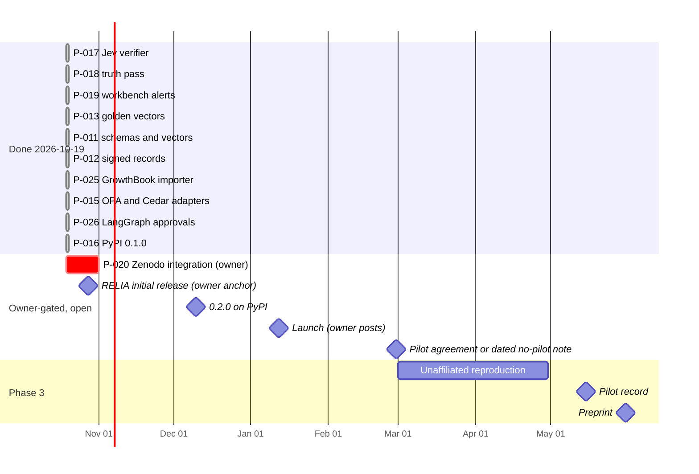

# ai-decision-system plan: re-verifiable records for AI go/no-go decisions

Status: refreshed 2026-10-25, `main` 97735ec [2026-10-19 snapshot: 726ff04];
model-coverage proposals added 2026-10-22, extended 2026-10-27 ([Model coverage](#model-coverage)). Owner:
Bicheng Wang. This directory is the source of truth for
direction and the delivery queue. Change
[`decisions.md`](decisions.md) first when direction changes. RELIA's own
[roadmap](../ai-workflows/ai-decision-reliability/docs/ROADMAP.md) stays
authoritative for RELIA's research and release milestones.

| File | Contents |
| --- | --- |
| [`decisions.md`](decisions.md) | Direction decisions (adopted and proposed), date, reason and what would reopen them |
| [`phase-0-ship-0.1.md`](phase-0-ship-0.1.md) | 2026-10-19 → 2026-11-01: packages on PyPI, every record verifiable, repository cleaned up |
| [`phase-1-records-spec.md`](phase-1-records-spec.md) | 2026-11-02 → 2026-12-13: schemas, conformance vectors, signed records, statistics cross-check, 0.2.0 |
| [`phase-2-bridges.md`](phase-2-bridges.md) | 2026-12-14 → 2027-02-28: importers for GrowthBook, OPA/Cedar and LangGraph; launch; first pilot |
| [`phase-3-external-evidence.md`](phase-3-external-evidence.md) | 2027-03-01 → 2027-05-31: unaffiliated reproduction, pilot record, regulatory mapping, preprint |

Plan IDs (`P-0NN`) are stable across phases. The [continual delivery task](../docs/CONTINUAL_DELIVERY.md)
turns `agent` rows of the active phase into `continual-ready` issues carrying the
Plan ID, and searches for that ID before creating anything.

## Identity

> A decision record carries the inputs and frozen rules needed for a third party
> to recompute an AI-assisted go/no-go decision offline, and says exactly what it
> does not prove. This repository defines those records and ships small,
> standard-library reference tools that produce and verify them at three
> decision points: a typed model answer, a policy-gated action with human
> approval, and an experiment promotion. RELIA is the human-gated reference for
> model release.

The identity is unchanged from the README. What changes is the emphasis: from
"three packages" to "a record format with reference verifiers", because the gap
is the record, not another platform.

- **Nobody else ships the replayable decision itself.** OPA decision logs carry
  input, result and bundle revision but are neither signed nor hash-chained, and
  fields can be masked ([OPA docs](https://www.openpolicyagent.org/docs/management-decision-logs)).
  MLflow approvals are mutable tags and aliases ([MLflow docs](https://mlflow.org/docs/latest/ml/model-registry/)).
  in-toto's verification summary predicate "does not include information for
  reproducing the verification result" ([SVR](https://github.com/in-toto/attestation/blob/main/spec/predicates/svr.md)).
  LangGraph approvals are checkpointed state, not evidence ([interrupts](https://docs.langchain.com/oss/python/langgraph/interrupts)).
- **Logging duties exist, formats don't.** EU AI Act Article 12 requires
  automatic event logs for high-risk systems without prescribing a format;
  Articles 19(1) and 26(6) require providers and deployers to keep the logs under
  their control for at least six months unless other law provides otherwise.
  Regulation (EU) 2026/1744 moved the application of Chapter III Sections 1 to 3
  to 2 December 2027 for Annex III high-risk systems and 2 August 2028 for Annex I
  (confirmed on EUR-Lex on 2026-10-19: [consolidated text](https://eur-lex.europa.eu/legal-content/EN/TXT/HTML/?uri=CELEX:02024R1689-20260727),
  [Regulation (EU) 2026/1744](https://eur-lex.europa.eu/legal-content/EN/TXT/HTML/?uri=CELEX:32026R1744)).
  ISO/IEC 42001 has a control A.6.2.8, "AI system recording of event logs"; its
  text is paywalled and was not reviewed. None of this makes our records compliance
  evidence; it makes "which inputs and which rules produced this decision" a question
  auditors will ask. See the [regulatory mapping](../docs/REGULATORY_MAPPING.md).
- **So we complement, not compete.** Signing and transport come from in-toto and
  Sigstore, policy from OPA or Cedar, statistics from the experiment platform,
  workflow from LangGraph. Our part is the record and its verifier.

## Where we start

| Fact | Value (2026-10-19 snapshot; dated 2026-10-25 refreshes below; old values in brackets where they changed) |
| --- | --- |
| Packages | `expgate`, `jevdecision`, `decisioncontrol` 0.1.0 tagged and GitHub-released 2026-10-13 (PR #224); `main` carries unreleased work for 0.2.0 (see [Completed](#completed)); version 0.2.0 is prepared (#263) but not dated, tagged or published. Source lines (`wc -l` of each package's `.py` files): 903 / 1,592 / 1,180 at the 0.1.0 tags, 2,045 / 2,563 / 2,562 on `main`. Tests on Python 3.15.0, `python3 -m unittest discover -s tests`: 208 / 189 / 240 run with 6 / 2 / 25 skipped [76 / 105 / 98 at 0.1.0]. The skips are tests that need dev-only dependencies (`jsonschema`, `langgraph`, `opa`, `cedar`), which CI installs |
| PyPI | All three 0.1.0 packages are published: [expgate](https://pypi.org/project/expgate/0.1.0/), [decisioncontrol](https://pypi.org/project/decisioncontrol/0.1.0/) and [jevdecision](https://pypi.org/project/jevdecision/0.1.0/). Owner-approved tag-scoped `release.yml` dispatches uploaded wheels and sdists on 2026-10-19 PDT (2026-10-20T05:29Z for expgate; 05:32Z for the other two). Every file has a trusted-publishing attestation naming `BichengWang/ai-decision-system`, `release.yml`, environment `pypi`. A clean Python 3.11 venv installed all three pinned versions and ran the root quickstart from the 0.1.0 tags; 0.2.0 remains unreleased |
| Verifiers | Every record type has a record-only verifier with tamper tests: `experiment-gate-verify`, `jev-decision-verify` (answer records and `--evaluation DIR`, #246) and `decision-control replay` / `replay-evaluation` [Jev had none, so P-009 held for two of three packages]. Each takes `--require-signature` (#253, #255, #256). Conformance vectors: 176 (54 valid, 62 tampered, 60 invalid): expgate 38, Jev 28, decision-control 110. `cd scripts/conformance && npm ci && node verify.mjs` reported `3 manifests, 176 vectors, 279 checks, 0 failures` on 2026-10-19 |
| Canonical form | Adopted 2026-10-19 and implemented: RFC 8785 (JCS) digests in expgate `decision.json` schema 3, Jev answer record schema 2 and decision-control record schemas 4 and 5 and `evaluation.json` schema 2 (#246, #248, #250, #257). Each package carries a standard-library `jcs.py` tested against shared RFC 8785 vectors, and the Node checker recomputes every valid vector's digest without Python (#249). Versions that were verifiable before keep their original canonicalization and still verify (expgate decision schema 2; decision-control records 1–3 and `evaluation.json` 1). Jev answer schema 1 and expgate decision schema 1 stay readable but unverifiable (exit 2). Jev `evaluation.json` and `provenance.json` have no canonical form; provenance pins exact file bytes. Derived floats compare at a relative 1e-9 in expgate verification and Jev re-scoring (decisions.md); decision-control compares exactly because it uses no libm function |
| RELIA | Candidate 0.1.5, spec 0.1.3, 1,098 source lines, 38 tests (38 passed on 2026-10-19); unreleased and human-gated. Its roadmap's September 2026 FTC comment (docket FTC-2026-1057, closed 2026-09-25) was filed as regulations.gov document FTC-2026-1057-0650 (received 2026-08-29, posted 2026-08-31) on the owner's confirmation and recorded in the RELIA roadmap by #242; it does not contain the technical description the roadmap planned. Initial release anchor set by the owner: 2026-10-28 |
| Workspace | `make workspace-check` passes (7 components; 6 before the `conformance` Node component of #249); every workflow on `main` 726ff04 is green, including `conformance (node)`, the three Sigstore attestation jobs and expgate's `golden vectors` |
| Security | 0 open Dependabot alerts on 2026-10-25 after #280 merged; all 45 alerts created 2026-10-23/24 (pillow 41 on `uv.lock`, certifi 3, opentelemetry-api 1) are `fixed` [45 open earlier on 2026-10-25; 0 on 2026-10-19; 100 on 2026-10-18]. Dependabot's pillow 13.0.0 bump (#276) updated `requirements.txt` only because streamlit 1.66.0 capped pillow below 13 in `uv.lock`. #280 moved `uv.lock` to pillow 13.0.0 / streamlit 1.66.1 / certifi 2026.10.23; `requirements.txt` to certifi 2026.10.23 and opentelemetry-api 1.45.1; dependency floors added. #236 and #244 upgraded or removed the previously vulnerable dependencies of the legacy `src/` workbench, which stays in this repository. Not re-checked: whether CI exercises the airllm 4.0.0 and transformers 5.19.0 bumps |
| Delivery loop | Last `continual-managed` PRs #218–#220 merged 2026-10-12. P-006–P-010 landed in PR #224; P-011–P-013, P-015, P-017–P-019 and P-025–P-028 followed on 2026-10-19 in PRs #234–#262. As of 2026-10-25, issues #238–#241 (created 2026-10-19) are all closed [#238 (P-016 docs) was open]; #238 closed as completed at 2026-10-20T05:43Z (#269) |
| Audience | 2026-10-25: 260 stars [172 on 2026-10-19], 18 forks [12], 10 watchers [9]; 0 open issues [1 (#238)]. Contributors (2026-10-19 snapshot): the owner (760 commits [743]) and Dependabot (38). Traffic and signal quality below are the 2026-10-18 measurements and were not repeated. Views 2026-10-04 → 17: 360 (163 unique), peak 2026-10-14 at 94 (73 unique); top referrer Google (23 unique) |
| Signal quality | (2026-10-18) 57 of 152 stargazers have 0 followers and at most 2 public repositories; about 33 accounts were under 60 days old when they starred. The 12 forks have 0 stars each and were last pushed 2026-10-09 → 13. Stars are not adoption evidence here |

## What the README looks like at month six

A visitor sees one install line, one verify line, and a table of record types
whose schemas and vectors any language can use. State on 2026-10-19: the table,
the signing line and the bridges line describe code that is on `main` and
unreleased (0.2.0); the `pip install` line installs published 0.1.0 (P-016 done).
Use a source install for the newer features until P-023. "Used by" has no
entries (no user has agreed to be named):

```markdown
pip install expgate jevdecision decisioncontrol   # 0.1.0; features below need 0.2.0/source

| Record | Schema | Verify offline | Vectors |
| --- | --- | --- | --- |
| Experiment promotion | `expgate/schema/decision.v<N>.json` | `experiment-gate-verify decision.json` | valid / tampered / invalid |
| Typed model answer | `jevdecision/schema/answer.v<N>.json` | `jev-decision-verify answer.json` | valid / tampered / invalid |
| Human-approved action | `decisioncontrol/schema/record.v<N>.json` | `decision-control replay --record record.json` | valid / tampered / invalid |

Signed records: in-toto Statement + DSSE; verify with the package or cosign.
Bridges: GrowthBook results → expgate; OPA/Cedar decisions → decision-control;
LangGraph interrupt approvals → decision-control.
Used by: (only entries the user agreed to publish)
```

## Target repository layout

Additions only; packages stay independent with standard-library runtimes. Every
path below exists on `main` as of 2026-10-19.

```text
ai-decision-system/
├── .plan/                                   # this plan
├── ai-workflows/<project>/
│   ├── <package>/schema/<record>.v<N>.json  # P-011, shipped as package data
│   └── conformance/{valid,tampered,invalid}/ # P-011, canonical bytes + digest per vector
├── ai-workflows/experiment-gate/tests/golden/ # P-013, reference-library vectors
├── ai-workflows/experiment-gate/expgate/importers/ # P-025 GrowthBook
├── ai-workflows/decision-control/decisioncontrol/adapters/ # P-015 OPA, Cedar
├── scripts/conformance/                     # P-011, independent Node schema and digest check
└── src/, tests/, root uv.lock               # stay; alerts triaged by P-019
```

## Calendar

Work landed ahead of the original schedule: P-011, P-012, P-013, P-015, P-017,
P-018, P-019, P-025 and P-026 merged on 2026-10-19 (the bars show that real
date; no earlier date is claimed). Targets that remain are for owner-gated items
and are not achieved until the owner acts. 0.2.0 stays targeted for 2026-12-10;
it can move earlier after P-020 and the owner release; P-016 is complete.



## Success measures

| By | Engineering | External evidence |
| --- | --- | --- |
| 2026-11-01 | `pip install expgate jevdecision decisioncontrol` works in a clean venv; every record type has a record-only verifier; no open critical or high Dependabot alerts | – |
| 2026-12-13 | 0.2.0 on PyPI with schemas, conformance vectors, golden-vector tests and optional signed records; a non-Python validator passes every vector in CI | – |
| 2027-02-28 | GrowthBook, OPA/Cedar and LangGraph bridges released | Launch done; first issue or PR from someone other than the owner; one pilot agreed in writing |
| 2027-05-31 | – | One unaffiliated reproduction recorded; one pilot record (any outcome) published with permission; preprint posted |

Status against these measures on 2026-10-19:

- **2026-11-01, engineering:** all three met. A clean Python 3.11 venv installed
  all three 0.1.0 packages from PyPI and ran the root quickstart from their tag
  source; every record type has a record-only verifier on `main`; no Dependabot
  alert is open (0 open). The Jev record-only verifier ships in 0.2.0, not 0.1.0.
- **2026-12-13, engineering:** schemas, conformance vectors, golden vectors,
  signed records and the non-Python validator (`conformance (node)`) are on
  `main`; **0.2.0 remains unpublished** (P-023; needs P-020 and the owner release).
- **2027-02-28:** the three bridges are on `main` and unreleased. Launch, a first
  outside issue or PR and a pilot agreement are **not met** (none exists; the
  contributors list shows only the owner and Dependabot).
- **2027-05-31:** not started; depends on P-023, P-027 and outside people.

Monthly PyPI downloads (pypistats, without mirrors) and stars are reported in the
quarterly review and never used as targets. A request is not a review, a review
is not use, and interest is not adoption.

## Non-goals

- A hosted service, dashboard or integrated runtime across the packages.
- Executing deployments, merges or ticket actions against external systems.
- Compliance certification or legal opinions; mappings name what a record covers
  and what it does not.
- New decision points before an outside user asks for one.

## Model coverage

Proposed 2026-10-22 and extended 2026-10-27 in [`decisions.md`](decisions.md); nothing below is built
until an outside user asks ([non-goals](#non-goals)). Records follow the go/no-go
decision, not the model family. Four families feed decisions here: generators
(LLMs) propose actions, System One decisioners (Jev, the OpenAI Decisions API)
answer typed questions with probabilities, embedding and ranking models order
candidates, and predictors trained on the operator's own outcomes score cases.
Only the decisioner and the predictor end in a go/no-go themselves; a ranking is
not one. Calibrators and optimizers also end in one. Generative image, audio and
video models (GANs, diffusion), simulators and perception models (OCR, speech,
vision) do not: they produce a proposal, a scenario or the state that a decision
reads. A diffusion policy is the exception, because its sample is the action.

| Model kind | Go/no-go it feeds | Record today | Gap | Plan |
| --- | --- | --- | --- | --- |
| System One decisioner (Jev; OpenAI Decisions with `gpt-6-luna`) | Gate, route, triage | Jev answer record: the raw response is stored and re-parsed | Text only: both APIs accept images, `jevdecision` sends none | On request |
| The decisioner as a reranker (one `Noul` per candidate) | Which candidates pass a probability cutoff | Jev answer record with one question per candidate | `jev-decision-eval` has no per-query NDCG or MRR | On request |
| LLM or agent proposing an action | A tool call that needs approval | decision-control; LangGraph example (P-026) | `Recommendation.model` and `probability` are labels the caller supplies; the LLM output behind them is not in the record | P-034 |
| LLM judge, reward model or guardrail | Release an output or not | Jev answer record when Jev is the judge | No backend for other LLM judges or reward models | On request |
| Calibrator or conformal wrapper over a decisioner or predictor | Answer, abstain or defer to a human | None: decision-control abstains below `min_probability` on the probability the caller supplies; `jev-decision-eval` reports ECE but fits no calibrator | The calibration-set digest, the fitted map or conformal quantile and the target coverage are not recorded, so a threshold on provider confidence carries no calibration evidence | On request |
| Model the operator trains and hosts (classifier, regressor, forecaster, uplift model, anomaly detector including GAN or diffusion reconstruction scores) | Approve/decline, flag, threshold, whom to treat | None per decision; RELIA trains this kind only inside its synthetic benchmark | No record, although the score could be recomputed from the model file. An uplift score has no per-case outcome to check against; only an online test (expgate) validates the targeting policy. GAN and diffusion scores need their framework to re-score | P-033 |
| Optimizer or solver (LP, MIP, constraint solver) | Which allocation, schedule or price set | None | A deterministic solve could be recomputed from the inputs, constraints, objective, solver version and seed, none of which is recorded | On request |
| Bandit, RL or diffusion policy | Which offer, price or robot action | None | A sampled action cannot be recomputed without its probability and the random draw; a diffusion policy also needs its noise seed and sampler settings | P-035 |
| Generative image, audio or video model (GAN, diffusion) | None of its own; releasing an output is the judge's decision | Jev answer record when Jev judges a text description; `jevdecision` sends no images | The output digest, seed and sampler settings are not recorded. GPU sampling is not bit-exact across hardware, so replay would check the stored output rather than regenerate it, as Jev re-parses its stored response | Not planned |
| Simulator, world model or synthetic-data generator (including GAN or diffusion) | None per request; feeds offline release gates | RELIA's synthetic benchmark (byte-reproducible in its pinned environment) | Outside RELIA, nothing records the generator version and seed behind a scenario or synthetic dataset | Not planned |
| Perception or extraction model (OCR, speech-to-text, vision) | None; it produces the state a decision reads | Jev answer record stores the state text it was sent | Neither the source document's digest nor the extractor's version is recorded, so replay cannot tell an extraction error from a decision error | Not planned |
| Dedicated reranker, recommender or embedding model | None per request; replacing the model is the decision | expgate (online test) or RELIA's ranking gate (offline) | None | Not planned |

P-033 to P-035 belong to no phase and are not `agent` rows, so the
[delivery task](../docs/CONTINUAL_DELIVERY.md) opens no issue for them. When an
outside user asks, the phase active at that time gets the row.

## Risks

| Risk | Mitigation |
| --- | --- |
| PyPI package-name takeover before first publication | Closed by P-016 on 2026-10-19 PDT: all three 0.1.0 projects are published with active trusted publishers |
| 100 open alerts in a governance repository read as negligence | Reopened 2026-10-23 with 45 alerts and closed again on 2026-10-25 by #280: 0 open [closed by P-019 (#236, #244): 0 open on 2026-10-19]. A new alert on the workbench is triaged the same way: upgrade or remove the dependency |
| A schema freeze locks in a canonical form other languages cannot reproduce | P-011 vectors carry canonical bytes in RFC 8785 form (adopted 2026-10-19), so another language's canonicalizer can be tested before any schema is published |
| Signed records leak decision metadata to a public transparency log | Keyed (HMAC) signing is the default; Sigstore is opt-in and documented as public |
| Adapters drift into a platform | Importers convert exported files only; no network clients, no services |
| Single maintainer | One phase at a time; exit criteria, not PR counts, define done |
| No outside user appears | Phase 2 outreach is explicit; a dated "no pilot" with the outreach log is published rather than relabeling self-produced runs |
| Live provider spend for Jev fixtures | Owner sets a hard cap before P-014; fixtures are recorded once and replayed |
| A record type is built that nobody asked for | P-033 to P-035 are gated on an outside user and sit in no phase, so the delivery task cannot pick them up ([Model coverage](#model-coverage)) |
| A pilot's decision needs P-033, so its protocol cannot freeze by 2027-02-28 | Offer the existing packages first. If the team's decision is a score from its own model, date the agreement on the decision point by 2027-02-28 and freeze the protocol when P-033 ships; P-032's date moves with it |

## Open items (2026-10-19)

Rows that are drafted or blocked. Finished rows are under [Completed](#completed);
each phase file carries a status table for every row of that phase.

| Plan ID | Status | What remains, and who does it |
| --- | --- | --- |
| P-014 | Blocked on owner | Owner supplies `TYPESAFE_API_KEY`, `OPENAI_API_KEY` and a hard spend cap; then the agent records the Jev live fixtures |
| P-020 | Blocked on owner | Owner enables the Zenodo GitHub integration by 2026-11-01. No DOI exists and none is claimed |
| P-021 | Owner decision pending | 2026-10-25: issues #238–#241 are all closed [#239, #240 and #241 were closed; #238 was open]; #238 completed 2026-10-20T05:43Z (#269). Owner decides whether to restart or retire the scheduled delivery task |
| P-022 | Recorded (#242); owner follow-up pending | Dates are in the RELIA roadmap. The filed comment has no technical content; RELIA's initial release (due 2026-10-28) follows RELIA's human-gated process and is not scheduled by this plan |
| P-023 | Prepared (#263); blocked on P-020 and owner release | Version 0.2.0 and `## [0.2.0] - Unreleased` changelogs are on `main`; 0.2.0 is not dated, tagged or published. P-016 is done; active PyPI publishers are configured. After enabling Zenodo (P-020), the owner runs `release.py prepare` with the date, tags and approves the `pypi` deployments. Target 2026-12-10 |
| P-024 | Drafted, owner action pending | Launch kit in [`docs/launch/`](../docs/launch/README.md) (#261). Owner posts on 2027-01-12 after P-023; no launch draft has been posted. Separately, a five-part progress series went out on Medium and LinkedIn on 2026-10-22 ([outreach log](../docs/launch/README.md#outreach-log)) |
| P-036 | Implemented 2026-10-22; owner setup pending | Merged in #273; #285 (2026-10-25) retries announcements not yet posted and pages through discussions. The [trigger](../docs/launch/README.md#trigger) opens the launch's tracking issue once 0.2.0 is on PyPI. Owner creates environment `outreach` (required reviewer), then sets repository variable `OUTREACH_ANNOUNCE=true`; until then the issue is its only output |
| P-027 | Drafted, owner action pending | Template in [`docs/PILOT_PROTOCOL.md`](../docs/PILOT_PROTOCOL.md) (#243). Owner recruits a team; none has agreed to anything. Proposed 2026-10-22: outreach opens by asking whether the team makes approve/decline decisions about people or accounts with a model it trains and hosts; a yes leads to P-033 |
| P-028 | Drafted, owner review pending | [`docs/REGULATORY_MAPPING.md`](../docs/REGULATORY_MAPPING.md) (#247, #258). It makes no compliance claim; ISO/IEC 42001 text was not reviewed |
| P-029 | Blocked on owner | Owner recruits an unaffiliated reviewer; needs 0.2.x on PyPI (P-023). Due 2027-04-30 |
| P-030 | Blocked on P-029 and P-032 | Preprint draft needs the reproduction and pilot outcomes. Due 2027-05-31 |
| P-031 | Not started, owner | Quarterly review and JOSS gate check |
| P-032 | Blocked on owner | Needs a pilot team (P-027) and its written permission. Due 2027-05-15 |
| P-033 | Proposed 2026-10-22; gated on an outside user | **Record for a score from an operator-hosted model**: features, model-file digest, calibrator, threshold policy, score and decision, with a verifier that recomputes the score ([decisions.md](decisions.md)). Starts when a pilot team (P-027) or an outside issue brings such a decision; a pilot that needs it freezes its protocol only after it ships. Owner recruits; agent builds |
| P-034 | Proposed 2026-10-22; gated on an outside user | **Bind LLM proposals in decision-control**: store the raw tool-call response that produced a `Recommendation` and re-derive the recommendation on replay, as Jev does for its answers. Needs record schema 6; the LangGraph example carries thread ids in the review note because the record has no metadata member. Starts when an outside decision-control user must show which model output produced an action. Agent builds |
| P-035 | Proposed 2026-10-22; gated on an outside user | **Record for a sampled action from a bandit, RL or diffusion policy**: the action probabilities and the random draw (for a diffusion policy, the noise seed and sampler settings), so the choice can be recomputed; logged probabilities would also let expgate approve a policy from off-policy evaluation instead of an online test. The owner's RL-pricing repository can serve as a test bed but is not outside evidence. Agent builds |

## Completed

Dates are America/Los_Angeles (UTC−07:00) calendar days. PRs #234–#263 merged between 2026-10-19T20:18Z and 2026-10-20T01:01Z, which is 13:18 to 18:01 on 2026-10-19 Pacific time; in UTC, some of them fall on 2026-10-20.

Merged after the 2026-10-19 snapshot and before the 2026-10-25 fixes below (`main` 5d0c8d1):
#264 (plan status), #265 (nested-doc link check), #266 (Jev conformance generator
`--check`/`--out`), #267 (expgate golden-vector generator hash lock), #268
(decision-control canonical decision ids in record schemas 4 and 5), #269
(published 0.1.0 docs; P-016 closed), #270 and #274 (notebook pruning in `src/`),
#271 (model-coverage proposals), #273 (P-036 outreach trigger), #275 (GitHub Pages
site serving schemas at their `$id` paths plus conformance vectors), and
#276–#279 (Dependabot bumps).

Fixes merged 2026-10-25 (`main` 97735ec). Each PR had an independent review with a PASS verdict and green required checks before the owner squash-merged it:

| PR | Change |
| --- | --- |
| #280 | Security pins and floors; 45 open Dependabot alerts to 0 (see [Security](#where-we-start)) |
| #281 | `continual_delivery` counts only today's merges; removes the 1,000-merged-PR lockout |
| #282 | `jev-decision` closes HTTPError responses |
| #283 | `workspace.py` rejects Python keywords as package names |
| #284 | Move uv dev dependencies to a PEP 735 dependency group |
| #285 | Outreach retries unposted announcements and paginates discussions (P-036) |

| Plan ID | Outcome | Evidence |
| --- | --- | --- |
| P-001 | Exact-head reviewed merge gate and recurring controller | #133 |
| P-002 | Repository links and commands repaired after the move to `ai-workflows/` | #172, #207 |
| P-003 | Bounded, CI-checked baseline for the legacy `src/` workbench | #173, #193 |
| P-004 | experiment-gate boundary and malformed-input coverage | #135, #144, #206 |
| P-005 | RELIA ranking path routed through the input guard | #176 |
| P-006 | Personal and infrastructure identifiers and third-party material removed; security, contribution, conduct and citation files added | #224 |
| P-007 | Wheels with console scripts, SPDX license metadata, single-source versions and changelogs; CI builds, `twine check --strict`, installs and smoke-runs each wheel | #224 |
| P-008 | Release-review defects fixed with regression tests (expgate unknown keys and zero-variance guardrails; Jev refusals, unknown probabilities and transport errors; decision-control self-approval, queue corruption and STALE exit codes) | #224 |
| P-009 | Tampering makes `experiment-gate-verify` and `decision-control replay` exit 1. Jev part moved to P-017 | #224 |
| P-010 | Tag-driven release workflow with `scripts/release.py check --tag`; GitHub Releases for all three 0.1.0 tags | #224; tags `*/v0.1.0` |
| P-011 | JSON Schemas (2020-12) shipped as package data and 176 conformance vectors (54 valid, 62 tampered, 60 invalid) for the three packages; expgate decision schema 3, Jev answer record schema 2 and decision-control record schema 4 (5 with P-015) and evaluation schema 2 use RFC 8785; Jev `evaluation.json` and `provenance.json` schema 2 have no canonical form (provenance pins exact file bytes); CI validates produced records against the schemas, and an independent Node/Ajv job (`scripts/conformance`) validates every vector's schema and recomputes every valid vector's digest. The check uses a pinned Ajv 8.20.0 script, not `ajv-cli` | #248 (expgate), #250 (decision-control), #251 and #252 (Jev), #249 (checker) |
| P-012 | Signed records: in-toto Statement v1 in a DSSE envelope, HMAC-SHA256 in-package and Sigstore through external `cosign`; `--require-signature` on `experiment-gate-verify`, `jev-decision-verify` and `decision-control replay` / `replay-evaluation`; CI signs keylessly with the GitHub OIDC identity and verifies with the package. Key handling is documented in `SECURITY.md`. **The owner has not yet approved key handling** (generation, storage, rotation as written there) | #253 (decision-control), #255 (Jev), #256 (expgate), #259 (docs), #262 (malformed signature fields) |
| P-013 | Golden vectors compare every `expgate.stats` estimator with scipy, statsmodels, gbstats and confseq; default tests read committed JSON without those libraries and a CI job regenerates and diffs them; the cross-check led to `exact_tail` options for tail probabilities | #237 |
| P-015 | Action registry (`reassign_ticket`, `set_ticket_priority`), record schema 5, OPA and Cedar adapters with fixtures recorded from OPA 1.21.2 and Cedar CLI 4.14.0; replay re-evaluates when the tool is on `PATH`, otherwise it is digest-only (exit 0 with a notice; `--require-reevaluation` exits 2) | #257 |
| P-016 | **Done 2026-10-19 PDT:** 0.1.0 of all three packages on PyPI, with wheels, sdists and GitHub trusted-publishing attestations | [expgate](https://pypi.org/project/expgate/0.1.0/), [decisioncontrol](https://pypi.org/project/decisioncontrol/0.1.0/), [jevdecision](https://pypi.org/project/jevdecision/0.1.0/); clean Python 3.11 pinned installation and root quickstart passed (details in [phase 0](phase-0-ship-0.1.md#status-2026-10-19)); docs follow-up #238 completed 2026-10-20T05:43Z (#269; confirmed 2026-10-25) [docs follow-up pending] |
| P-017 | `jev-decision-verify` for answer records (schema 2 embeds the questions and the raw response under an RFC 8785 digest) and `--evaluation DIR`; schema 1 answers stay readable and exit 2; completes P-009 | #246, #251, #252; signing #255 |
| P-018 | Stale status claims corrected: RELIA roadmap and changelog, `CITATION.cff` (`version`, `date-released`, `license`), `scripts/README.md` and the CONTRIBUTING link | #234 |
| P-019 | 2026-10-25: 0 open Dependabot alerts after #280 fixed the 45 created 2026-10-23/24 [0 open on 2026-10-19, every alert `fixed`, none dismissed; 100 open on 2026-10-18]; `src/` stays in the repository. On 2026-10-19, the bounded `src baseline` check was green and `make workspace-check` passed (7 components; the P-019 acceptance said 6, before #249 added the `conformance` component) | #236, #244, #280 |
| P-025 | `experiment-gate --from growthbook results.json --mapping mapping.json` converts a GrowthBook results export into a schema-3 record that keeps the export's digest; fixtures were captured from a throwaway self-hosted GrowthBook 5.1.0 with synthetic data, so this is software-behavior evidence and no real GrowthBook user has run it | #254 |
| P-026 | LangGraph example mapping `interrupt()` and `Command(resume=…)` onto decision-control submit and approve/reject and an exported record that replays; the proposer's own approval is refused, and a forged record naming the proposer as reviewer fails replay with exit 1; LangGraph is a dev-only dependency tested in CI | #260 |
