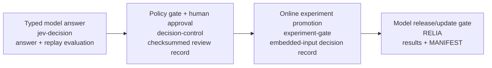

# AI Decision System

[](https://github.com/BichengWang/ai-decision-system/actions/workflows/expgate-ci.yml) [](https://github.com/BichengWang/ai-decision-system/actions/workflows/jev-decision-ci.yml) [](https://github.com/BichengWang/ai-decision-system/actions/workflows/decision-control-ci.yml) [](https://github.com/BichengWang/ai-decision-system/actions/workflows/conformance.yml) [](https://pypi.org/project/expgate/) [](https://pypi.org/project/jevdecision/) [](https://pypi.org/project/decisioncontrol/)  [](LICENSE) [](https://bichengwang.github.io/ai-decision-system/)

Replayable, offline-verifiable records for AI-assisted go/no-go decisions.

Site, schemas and conformance vectors: <https://bichengwang.github.io/ai-decision-system/>

## Why

Model output is not authority. Promotions, approvals and releases need a record
that a third party can re-check against frozen inputs and rules. Dashboards and
logs can describe what happened; re-verifiable evidence also preserves what is
needed to recompute the decision.



These are **independent packages, not one integrated runtime**. The arrows show
possible decision points, not implemented cross-package connections. Each emits
a machine-checkable record; verification mechanisms and retained-input needs
vary. See [Decision record conventions](docs/DECISION_RECORDS.md).

## Components

| Component | Decision point | Package | Record and offline check | Status |
| --- | --- | --- | --- | --- |
| [Jev decision](ai-workflows/jev-decision/README.md) | Typed yes/no, choice and score answers; labeled quality gates | `jevdecision` | Typed answer, `evaluation.json`, provenance; `jev-decision-verify answer.json`, `jev-decision-eval --responses …` with retained questions/cases/requirements | 0.1.0 on GitHub and PyPI; schemas, verifier and signing arrive in 0.2.0 (unreleased on `main`) |
| [decision-control](ai-workflows/decision-control/README.md) | Frozen routing policy, human approval and local ticket action | `decisioncontrol` | Exported record; `decision-control replay --record …` | 0.1.0 on GitHub and PyPI; registry, OPA/Cedar adapters, LangGraph example and signing arrive in 0.2.0 (unreleased on `main`) |
| [Experiment gate](ai-workflows/experiment-gate/README.md) | SHIP / HOLD / ROLLBACK / INVALID from exported A/B aggregates | `expgate` | `decision.json`; `experiment-gate-verify …` | 0.1.0 on GitHub and PyPI; schema 3, GrowthBook importer and signing arrive in 0.2.0 (unreleased on `main`) |
| [RELIA](ai-workflows/ai-decision-reliability/README.md) | Synthetic model release and guarded update | Not published | `results.json`, `MANIFEST.json`; `python -m relia.compare … --protocol …` in its environment | Unreleased; human-gated |

The three small packages require Python 3.11+ and use only the standard library
at runtime. decision-control is a trusted local SDK/CLI, not an identity service
or external executor. Experiment gate consumes summaries; it does not run an
experiment or deploy a model. Jev supports Jev and OpenAI Decisions backends;
provider-reported confidence is not a calibrated safety guarantee.

Since 0.1.0, `main` also has (all unreleased; see each CHANGELOG): JSON Schemas and
conformance vectors for every record type, re-checked by an independent Node job
([`scripts/conformance`](scripts/conformance/README.md)); RFC 8785 digests in the
current schemas; `jev-decision-verify`; optional signed records (`--sign-key`,
`--require-signature`: an in-toto Statement in a DSSE envelope, HMAC in-package,
Sigstore through external `cosign`); an action registry with OPA and Cedar adapters
and a LangGraph approvals example in decision-control; and
`experiment-gate --from growthbook`. These bridges and fixtures are
software-behavior evidence on synthetic data; no outside use is claimed.
A signature shows the holder of a key signed the bytes, not who that person is.

## Quickstart from a clone

Use Python 3.11+ in a virtual environment. For the published 0.1.0 packages:

```sh
pip install expgate jevdecision decisioncontrol
```

Features documented on `main` beyond 0.1.0 arrive with 0.2.0, which is not
published yet. Until then, install each independent project from source:

```sh
pip install "git+https://github.com/BichengWang/ai-decision-system#subdirectory=ai-workflows/experiment-gate"
pip install "git+https://github.com/BichengWang/ai-decision-system#subdirectory=ai-workflows/jev-decision"
pip install "git+https://github.com/BichengWang/ai-decision-system#subdirectory=ai-workflows/decision-control"
```

Run the examples below **from a clone's repository root**, with new output paths.
Examples are in the source tree/sdist, not installed as wheel package data.

```sh
experiment-gate --input ai-workflows/experiment-gate/examples/offer-ranker-v2.json --out /tmp/expgate-new
experiment-gate-verify /tmp/expgate-new/decision.json
cat /tmp/expgate-new/DECISION.md
```

```sh
jev-decision --questions ai-workflows/jev-decision/examples/support-ticket.json --state "My payouts failed" --dry-run
jev-decision-eval --questions ai-workflows/jev-decision/examples/support-ticket.json \
  --cases ai-workflows/jev-decision/examples/support-ticket-cases.jsonl \
  --responses ai-workflows/jev-decision/examples/support-ticket-responses.jsonl \
  --require ai-workflows/jev-decision/examples/support-ticket-requirements.json --out /tmp/jev-new
cat /tmp/jev-new/EVALUATION.md
```

```sh
decision-control demo --out /tmp/control-new
decision-control replay --record /tmp/control-new/record-review.json
cat /tmp/control-new/summary.json
```

The 0.1.0 packages are on PyPI with trusted-publishing attestations; 0.2.0 remains
unreleased. Live Jev calls require
`TYPESAFE_API_KEY` (Jev) or `OPENAI_API_KEY` (OpenAI). The examples above make no
provider calls and use hand-written/synthetic fixtures. They are software checks,
not live-model, calibration, adoption or production evidence. Hashes detect
change, not forgery; identities are caller-asserted and provider origin is not
authenticated.

## How this differs

These tools complement existing platforms; the bounded contribution is retained,
re-checkable decision evidence, not a replacement for their operational features.

| Category | Typical role | This repository's scope |
| --- | --- | --- |
| Experiment platforms (GrowthBook, Statsig, Eppo) | Compute and manage experiment statistics in a platform | expgate consumes exported aggregates (a GrowthBook results export can be imported) and emits a re-verifiable promotion decision |
| Policy engines / human review (OPA, Cedar, LangGraph interrupts) | Decide authorization or pause a workflow for review | decision-control freezes policy, proposer and review into replayable evidence with label-based separation of duties; it can freeze an OPA or Cedar decision and has a LangGraph approvals example |
| Evaluation tools (promptfoo, OpenAI Evals) | Score prompts and model behavior | Jev gates typed answers with explicit PASS/FAIL/UNGATED and refusal/unknown-confidence semantics |
| Registries / monitoring (MLflow, Evidently) | Track models and monitor performance | RELIA provides byte-reproducible synthetic release gates in its pinned environment |

RELIA uses its own Python 3.13 environment (3.13.7 pinned for reproduction).
[Its reproduction protocol](ai-workflows/ai-decision-reliability/docs/REPRODUCE.md)
requires fresh runs and separate reference comparison/reviewer attestations.
Synthetic results do not establish real-world commercial performance, fairness,
legal compliance or consumer benefit. Thresholds are proposed engineering gates,
not industry/government standards; no agency endorsement is claimed.
**No accepted RELIA public release is claimed.** Rights clearance, unaffiliated
reproduction and acceptance remain [human-gated](docs/RELIA_RELEASE.md).

## Workspace navigation and validation

The [workspace guide](ai-workflows/README.md) and [manifest](workspace.json)
register independent environments, ownership, CI checks and commands.
With Python 3.11+ resolved as `python3`:

```sh
make workspace-list
make workspace-check
make affected BASE=origin/main
make affected-test BASE=origin/main
make workspace-test COMPONENTS="experiment-gate jev-decision decision-control"
make release-status
make records-demo DEMO_OUT=/abs/new/dir
```

`workspace-check` tests tooling and checks syntax, boundaries, CI consistency and
Markdown links; it does not run every behavioral suite. `affected-test` needs
prepared component environments. `release-status` inspects candidate metadata
(Python 3.11+). `records-demo` writes and verifies experiment records, runs Jev
fixture replay, then exports/replays a local review record; it requires an absolute
new directory and prints retained record paths. See the [Makefile](Makefile).
For RELIA use `make relia-sync`, `make relia-test` and
`make relia-reproduce RELIA_OUT=/abs/new/dir`; a local pass is not release acceptance.

The older `src/` [research workbench](src/README.md) has a separate root
environment. Its limited service-free `make test` baseline uses Python 3.11
(the pinned pandas 1.5.3 lacks Python 3.12+ wheels); broker, browser and ML probes
need separate services/environments. Root tests do not validate the whole repo.

## Licensing and project guides

The three small packages carry their own MIT licenses; the root [MIT license](LICENSE)
covers the research material within its scope. [RELIA's license status](ai-workflows/ai-decision-reliability/LICENSE)
grants no current rights; intended Apache-2.0 publication requires rights clearance.
See [SECURITY](SECURITY.md), [CONTRIBUTING](CONTRIBUTING.md), [CITATION](CITATION.cff),
[records](docs/DECISION_RECORDS.md), [releasing](docs/RELEASING.md),
[pilot protocol template](docs/PILOT_PROTOCOL.md), [regulatory mapping (draft, no compliance claim)](docs/REGULATORY_MAPPING.md),
[documentation index](docs/README.md) and [plan](.plan/README.md).

[Maintainer portfolio and publication evidence](docs/portfolio/).
