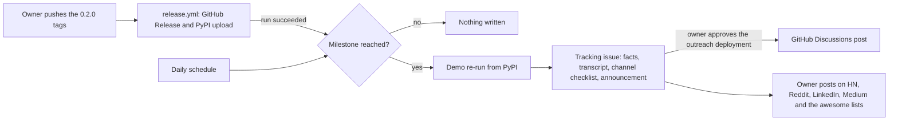

# Launch kit (Plan ID P-024)

Drafts for the launch described in the [Phase 2 plan](../../.plan/phase-2-bridges.md).
None of the launch drafts here has been posted, submitted or sent. Separately, on
2026-10-22 a five-part progress series, "Decisions you can replay", went out on the
owner's Medium and LinkedIn accounts (rows in the [outreach log](#outreach-log)).
Launch status: kit drafted; owner posts on **2027-01-12**, after P-023 (0.2.0) and
P-025 (GrowthBook importer). The [trigger](#trigger) (P-036) opens the launch's
tracking issue once 0.2.0 is on PyPI.

| File | Venue | Why this venue |
| --- | --- | --- |
| [`show-hn.md`](show-hn.md) | Hacker News (Show HN) | Something readers can install and run from a clone |
| [`reddit.md`](reddit.md) | r/MachineLearning (`[P]`) and r/mlops | Both have a project route; rules checked 2026-10-19 |
| [`linkedin.md`](linkedin.md) | LinkedIn, the owner's own profile | Reaches practitioners who run release gates |
| [`medium.md`](medium.md) | Medium, the owner's own account | Long form: room for the forged-record case and where the records fit; rules checked 2026-10-22 |
| [`github-discussion.md`](github-discussion.md) | GitHub Discussions, Announcements | The repository's own channel, next to the code; the trigger fills it in |
| [`awesome-list-prs.md`](awesome-list-prs.md) | kelvins/awesome-mlops, AthenaCore/AwesomeResponsibleAI, agentrust-io/awesome-ai-governance | Rules read from each repository; entries checked against each list's format |

[EthicalML/awesome-production-machine-learning](https://github.com/EthicalML/awesome-production-machine-learning)
is **not a target**: its [CONTRIBUTING.md](https://github.com/EthicalML/awesome-production-machine-learning/blob/master/CONTRIBUTING.md)
requires at least 500 GitHub stars per tool.

## Trigger

[`milestones.json`](milestones.json) lists the milestones that start outreach;
[`scripts/outreach.py`](../../scripts/outreach.py) checks them, and
[`outreach.yml`](../../.github/workflows/outreach.yml) runs it after every successful
`Component release` run and daily at 16:37 UTC. A milestone is a set of facts, not a
date or a star count. The one milestone today, `packages-0.2.0` (P-023, then P-024),
is reached when expgate, jevdecision and decisioncontrol 0.2.0 are on PyPI with no
file yanked, every file carries a provenance whose publisher is this repository's
`release.yml` in environment `pypi`, and the three GitHub Releases are published.



When a milestone is reached, `start`:

1. For a new or demo-blocked issue, re-runs the milestone's demo in an empty
   directory, from PyPI, with no token in its environment. Every step must exit 0
   and print the lines the manifest expects.
2. Opens one issue, `Outreach: <milestone title>`, with the facts it checked, the
   transcript, a checkbox per channel and the filled-in
   [announcement](github-discussion.md). Later runs find the issue by its
   `<!-- outreach-milestone: <id> -->` marker and preserve its body, including owner
   edits. If the demo failed, the issue carries the blocker and no announcement,
   and each later run re-runs the demo and replaces the issue body until the demo
   passes.
3. On every run, rechecks the release requirements and hands each reached,
   non-blocked milestone with an announcement to the `announce` job, including
   existing issues whose announcement title is not already posted in repository
   discussions. Already-posted announcements on existing issues are not offered
   for approval again. A skipped, rejected or failed announcement can therefore
   be retried on a later run. The job runs only when repository variable
   `OUTREACH_ANNOUNCE` is `true` and waits for the owner to approve the `outreach`
   environment deployment. It posts the issue's text between the
   announcement markers as it is at that moment, so edit it in the issue first. It
   checks all pages of existing discussions, posts each title once and comments
   the discussion link on the issue only when creating a post.

Nothing else is posted automatically:

| Venue | Who | Why |
| --- | --- | --- |
| GitHub Releases | `release.yml` | Already automated per tag |
| PyPI | `release.yml` uploads; the trigger checks version, files and provenance | PyPI has no announcement feature; the project page is the README uploaded with the release |
| GitHub Discussions | `announce` job, after approval | The repository's own channel |
| Hacker News, Reddit | Owner | The [HN guidelines](https://news.ycombinator.com/newsguidelines.html) and r/mlops rule 3 exclude generated posts |
| LinkedIn | Owner | A member access token lasts 60 days ([LinkedIn OAuth](https://learn.microsoft.com/en-us/linkedin/shared/authentication/authorization-code-flow)) and refresh tokens are only for approved Marketing Developer Platform partners ([refresh tokens](https://learn.microsoft.com/en-us/linkedin/shared/authentication/programmatic-refresh-tokens)), so a trigger firing on an unknown date would hold an expired token |
| Medium | Owner | Medium [issues no new API tokens](https://help.medium.com/hc/en-us/articles/213480228-API-Importing) |
| Awesome lists | Owner | Pull requests to other people's repositories |

One-time setup, by the owner, after this is merged to `main` (`workflow_run` and
`schedule` only run the default branch's copy of a workflow):

1. Create GitHub environment `outreach` with required reviewer BichengWang and
   deployment branch `main`.
2. Then set repository variable `OUTREACH_ANNOUNCE=true`. Until then the issue is
   the trigger's only output. Do not set it first: a job that names a missing
   environment creates it without protection rules. If the tracking issue already
   exists, the next trigger run offers its announcement for approval only if its
   title is not already posted in repository discussions.

Locally, with an authenticated `gh`:

```sh
python3 scripts/outreach.py status                          # started, reached or not reached, and why
python3 scripts/outreach.py demo packages-0.2.0             # the demo alone, transcript to stdout
python3 scripts/outreach.py start --dry-run                 # print the issue instead of opening it
python3 scripts/outreach.py announce packages-0.2.0 --dry-run
```

A new milestone is a new entry in `milestones.json`: `requires` (PyPI versions and
GitHub Release tags), an optional `demo` and `announcement`, and its `channels`.

## What every post says

1. **Problem first.** An AI-assisted go/no-go decision is often kept as a
   dashboard state or a log line. Months later nobody can recompute it from what was
   kept: the inputs moved, the thresholds were edited, the approval was a mutable tag.
2. **One install line, one verify line, one demo.** The demo is the signed-record
   run below, copied verbatim.
3. **What the records do not prove.** Every post states this, in the same words as
   the [project identity](../../.plan/README.md#identity) and the
   [experiment-gate README](../../ai-workflows/experiment-gate/README.md#signed-records):
   - A passing check shows the record is internally consistent under the verifier's
     rules. It does not show the decision was right, and it does not authorize a
     deployment.
   - It does not show the experiment summary behind it is true; the inputs are
     whatever the producer supplied.
   - An HMAC signature shows the signer held the shared secret. It is not an
     identity: every verifier holds the same key and so could also sign.
   - It is not compliance evidence or a legal opinion.
   - The bundled scenarios are synthetic. They are software checks, not adoption evidence.
4. **No adoption claims.** There are no users, pilots or reviews to cite. Do not
   add any, and do not quote stars (see [decisions](../../.plan/decisions.md)).

## Install and verify lines

| | Line | State on 2026-10-19 |
| --- | --- | --- |
| Install, from a clone | `pip install ./ai-decision-system/ai-workflows/experiment-gate` | Works today (run below) |
| Install, from PyPI | `pip install "expgate>=0.2.0"` | **After 0.2.0 PyPI publish (pending, P-023).** 0.1.0 is on PyPI (P-016 done), but signing (`keygen`, `--sign-key`, `--require-signature`) needs 0.2.0. Until then use the source install above |
| Verify | `experiment-gate-verify review-run/*/decision.json --require-signature --key signing.key` | Works today (run below) |

## The demo, as run

Run on 2026-10-19, macOS arm64, Python 3.15.0, from a fresh clone of `main` at
commit `44e3519` (`expgate` 0.1.0 as reported by `expgate.__version__`; the
signing code is on `main` but unreleased). Each command was run in order, in an empty temporary directory, and the
output is pasted unedited. The key id is random per `keygen` and differs on every
run. Exit codes are printed by the `echo` on the same line as the command.

```text
$ git clone --quiet https://github.com/BichengWang/ai-decision-system.git && git -C ai-decision-system rev-parse --short HEAD
44e3519
$ python3 -m venv .venv && . .venv/bin/activate
$ pip install --quiet ./ai-decision-system/ai-workflows/experiment-gate
$ experiment-gate keygen signing.key
{
  "key_file": "signing.key",
  "key_id": "hmac-sha256:1981ba6cb5d68a4b"
}
$ experiment-gate --all-scenarios --out review-run --sign-key signing.key
cuped: HOLD 37973c767a4265a4a87b92b2b3eff73d0ba1fad912f1a74211c4f37219b04789
early-regression: ROLLBACK 3ff09f7c0e673475600a8791b50a6de1d35a3b0cae137f21ae9c9c73ff84cbf6
flat: HOLD 9b40598f1374d57ec3352aec328b29337fef0069f8f0ff49b2560e6b6ea4ddd4
guardrail-breach: ROLLBACK 619380333c81df2aa03371cf35426f6fb92d3a3f36e7a878cddb614c66f455e4
regression: ROLLBACK fd57cfd34dd2e3e8eceff79cf8b6171143a9da9426a302cc12b3427a6aa92b1b
srm: INVALID adb4b16cd36a0565004fd6bfcb3a7486b59b211013effa9d9d20adbc24ae8f0d
win: SHIP 563c56b0fead3034182bfed5a77e5666cb263e2814a59e4ac39d650482bee4c8
$ experiment-gate-verify review-run/*/decision.json --require-signature --key signing.key; echo "exit code: $?"
review-run/cuped/decision.json: verified
review-run/early-regression/decision.json: verified
review-run/flat/decision.json: verified
review-run/guardrail-breach/decision.json: verified
review-run/regression/decision.json: verified
review-run/srm/decision.json: verified
review-run/win/decision.json: verified
exit code: 0
$ sed -i.bak 's/"decision": "HOLD"/"decision": "SHIP"/' review-run/flat/decision.json
$ experiment-gate-verify review-run/flat/decision.json --require-signature --key signing.key; echo "exit code: $?"
review-run/flat/decision.json: signature: signature covers different record bytes
exit code: 1
```

The posts use exactly the lines above, through the first `exit code: 1`. The rest of
the same run shows what the signature adds beyond the digest:

```text
$ experiment-gate-verify review-run/flat/decision.json; echo "exit code: $?"
review-run/flat/decision.json: mismatch: decision
exit code: 1
$ mv review-run/flat/decision.json.bak review-run/flat/decision.json
$ python3 -c "import json; d = json.load(open('review-run/flat/decision.json')); m = d['input']['arms']['treatment']['metrics']; m['conversion']['successes'] = 400; m['refund_rate']['successes'] = 20; json.dump(d['input'], open('edited.json', 'w'))"
$ experiment-gate --input edited.json --out forged
flat: SHIP ef8544d6fbb16d65b94fe0aef48a536ef69843f5f0c0554e036038601d4e14aa
$ cp forged/decision.json review-run/flat/decision.json
$ experiment-gate-verify review-run/flat/decision.json; echo "exit code: $?"
review-run/flat/decision.json: verified
exit code: 0
$ experiment-gate-verify review-run/flat/decision.json --require-signature --key signing.key; echo "exit code: $?"
review-run/flat/decision.json: signature: signature covers different record bytes
exit code: 1
```

Reading it: the first edit (a value changed in place) fails the replay without a
signature too (`mismatch: decision`). The second edit changes the input and
re-derives the whole record with the real tool; the digest check and replay then
pass (`verified`, exit 0), and only the signature check, which binds the exact
bytes of the file to the key, exits 1. This is the case a bare digest cannot catch.
The same flags exist on `decision-control` and `jev-decision`
(see their READMEs); the demo uses only `experiment-gate`.

## Before posting (owner checklist)

Re-do every item on the day. The outputs above are a record of 2026-10-19, not of the release.

- [ ] **Release state.** P-016 done (`pip index versions expgate` lists a version),
      P-023 done (0.2.0 or later on PyPI, tagged), P-025 shipped. If any is still
      pending, post nothing and move the date in the plan.
- [ ] **Re-run the demo** against what you are posting. After 0.2.0 the printed
      decision hashes change (the record carries `expgate_version`) and the key id
      always changes. The milestone's tracking issue carries a run from PyPI in a
      clean virtual environment, made by the [trigger](#trigger); use it, or run
      `python3 scripts/outreach.py demo packages-0.2.0` again. Replace the code
      block in every file under `docs/launch/` with that output, pasted unedited.
      Swap the install line to `pip install "expgate>=0.2.0"` and remove the
      "(pending)" marker only then.
- [ ] **Claims.** Search the kit for adoption, user, pilot, review, compliance and
      PyPI wording. Add a fact only if it exists that day and you can link to it.
      If the GrowthBook importer (P-025) is mentioned, run its command first.
- [ ] **Repository.** Open Dependabot alerts: if critical or high alerts remain,
      the README must still say they are confined to the legacy workbench
      (P-019). Links in the README resolve. `main` CI is green.
- [ ] **Own words.** Rewrite each draft in your own words before posting. The
      [HN guidelines](https://news.ycombinator.com/newsguidelines.html) ask for
      text you wrote yourself, and r/mlops rule 3 excludes low-effort and
      machine-written posts. Keep the commands and outputs verbatim.
- [ ] **Rules.** Re-read each venue's rules (links in each file). They change.
- [ ] **Be present.** Plan to answer comments for the first few hours. Do not ask
      anyone to upvote or comment ([Show HN guidelines](https://news.ycombinator.com/showhn.html)).
- [ ] **Log it** in the table below the same day.

Suggested order, not a rule from any venue: awesome-list PRs and the Show HN on
the same day (both link to the repository), the subreddits after the first
comments on HN are read, LinkedIn and Medium last. Post each only once. Approve
the GitHub Discussions announcement whenever its text is ready; it can go first.

## Outreach log

One row per outreach, filled by the owner on the day and again when a response
arrives. Response is one of **accepted**, **declined** or **silent**. Suggested
meaning of silent: no response from maintainers or readers 14 days after the date;
record the date you checked. Also note any issue or PR from someone other than the
owner; the [phase 2 exit criteria](../../.plan/phase-2-bridges.md#exit-criteria)
count those, and a dated "none arrived" counts too.

For GitHub Discussions, log the actual post using the link commented on the
tracking issue. Skipped, rejected or failed announce jobs can be retried by the
next trigger run; they are not posts. A retry that finds the same title already
posted creates neither a new discussion nor another log row.

| Date | Venue | Link | Response (accepted / declined / silent) | Response date | Non-owner issue or PR (link, or none) | Notes |
| --- | --- | --- | --- | --- | --- | --- |
| 2026-10-22 | Medium | [part 1](https://medium.com/@bichengwang17/your-ai-shipped-a-model-can-you-prove-why-six-months-later-da0ca762c808) | [ ] | [ ] | [ ] | "Decisions you can replay" part 1 of 5; progress series, not the 0.2.0 launch |
| 2026-10-22 | Medium | [part 2](https://medium.com/@bichengwang17/a-hash-wont-stop-the-forger-who-uses-your-own-tool-3672ce42f390) | [ ] | [ ] | [ ] | Part 2 of 5: signed records |
| 2026-10-22 | Medium | [part 3](https://medium.com/@bichengwang17/one-2-0-broke-my-json-hash-in-node-js-571078ea7f58) | [ ] | [ ] | [ ] | Part 3 of 5: RFC 8785 and conformance vectors |
| 2026-10-22 | Medium | [part 4](https://medium.com/@bichengwang17/5-of-7-decisions-made-on-a-mac-failed-to-replay-on-linux-a9f5e5d192a8) | [ ] | [ ] | [ ] | Part 4 of 5: cross-platform replay and golden vectors |
| 2026-10-22 | Medium | [part 5](https://medium.com/@bichengwang17/your-langgraph-approval-is-not-evidence-3bb623a387f3) | [ ] | [ ] | [ ] | Part 5 of 5: GrowthBook, OPA/Cedar and LangGraph bridges |
| 2026-10-22 | LinkedIn | [part 1](https://www.linkedin.com/feed/update/urn:li:share:7519137125326381056/) | [ ] | [ ] | [ ] | Links Medium part 1 |
| 2026-10-22 | LinkedIn | [part 2](https://www.linkedin.com/feed/update/urn:li:activity:7519137322353745920/) | [ ] | [ ] | [ ] | Links Medium part 2 |
| 2026-10-22 | LinkedIn | [part 3](https://www.linkedin.com/feed/update/urn:li:activity:7519137578223050752/) | [ ] | [ ] | [ ] | Links Medium part 3 |
| 2026-10-22 | LinkedIn | [part 4](https://www.linkedin.com/feed/update/urn:li:activity:7519137826282790912/) | [ ] | [ ] | [ ] | Links Medium part 4 |
| 2026-10-22 | LinkedIn | [part 5](https://www.linkedin.com/feed/update/urn:li:activity:7519138065618120704/) | [ ] | [ ] | [ ] | Links Medium part 5 |
| [YYYY-MM-DD] | Hacker News (Show HN) | [url] | [ ] | [ ] | [ ] | [ ] |
| [YYYY-MM-DD] | r/MachineLearning `[P]` | [url] | [ ] | [ ] | [ ] | [ ] |
| [YYYY-MM-DD] | r/mlops | [url] | [ ] | [ ] | [ ] | [ ] |
| [YYYY-MM-DD] | LinkedIn | [url] | [ ] | [ ] | [ ] | [ ] |
| [YYYY-MM-DD] | Medium | [url] | [ ] | [ ] | [ ] | [ ] |
| [YYYY-MM-DD] | GitHub Discussions, Announcements | [url] | [ ] | [ ] | [ ] | [ ] |
| [YYYY-MM-DD] | PR to kelvins/awesome-mlops | [url] | [ ] | [ ] | [ ] | [ ] |
| [YYYY-MM-DD] | PR to AthenaCore/AwesomeResponsibleAI | [url] | [ ] | [ ] | [ ] | [ ] |
| [YYYY-MM-DD] | PR to agentrust-io/awesome-ai-governance | [url] | [ ] | [ ] | [ ] | [ ] |
